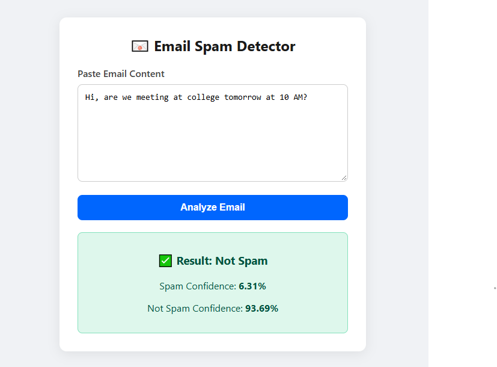

# Email Spam Detection using Machine Learning and Generative AI

Deployment URL : https://email-spam-detector-qr9s.onrender.com

This project detects spam emails using Machine Learning
and provides AI-based explanations.

## Machine Learning Models

- Logistic Regression
- Multinomial Naive Bayes
- Random Forest

## Technologies

- Python
- Pandas
- NumPy
- Scikit-learn
- Flask
- React
  

  